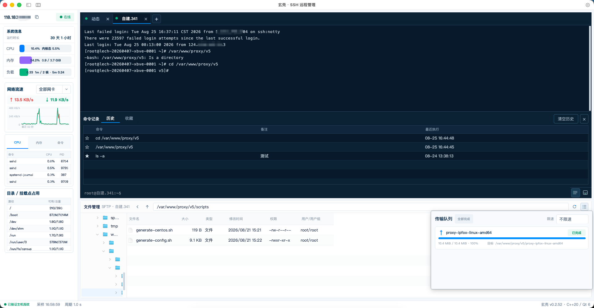

<p align="center">
  
</p>

<h1 align="center">玄壳 NoxShell</h1>

<p align="center">
  一款面向服务器运维的现代化远程连接客户端。<br>
  同时管理 SSH 终端与 Windows 远程桌面，并在紧凑工作区中完成监控、文件管理和远程编辑。
</p>

<p align="center">
  <a href="https://github.com/abcxi/NoxShell/releases/latest"></a>
  <a href="LICENSE"></a>
  
  
  
  
</p>

<p align="center">
  <a href="#下载">下载</a> ·
  <a href="#核心功能">核心功能</a> ·
  <a href="#开源许可">开源许可</a> ·
  <a href="#本地构建">本地构建</a>
</p>



> 截图使用本地演示会话生成，不包含真实服务器凭据。当前源码版本：`v0.2.92`（本地测试版本，尚未发布；已发布版本以 Releases 为准）。

本轮的采样频率、安全措施和已知边界见 [性能与安全说明](docs/PERFORMANCE_AND_SAFETY.md)。

## 为什么选择玄壳

| 一站式运维 | 原生桌面体验 | 会话互不干扰 | 安全保存凭据 |
| --- | --- | --- | --- |
| 终端、监控、文件和编辑器同屏协作 | C++20 + Qt 6，界面紧凑、启动迅速 | 每个标签拥有独立 SSH 连接与配置快照 | 密码和私钥口令加密保存，不写入主机 SQLite |

玄壳适合需要同时管理 Linux 服务器和 Windows 电脑、频繁查看资源状态、编辑配置文件和传输文件的开发与运维人员。它不试图把功能藏进层层页面，而是把最常用的操作放在一个可拖动、可收起的工作区内。

## 核心功能

### 连接工作区

- 右侧起始页提供“访问历史”“服务器管理”和“密码管理”三个选项卡，不再占用独立的左侧服务器栏。
- 未登录及浏览起始页时，自动收起下方文件区，让列表铺满右侧高度；切回终端恢复文件区，并保留手动隐藏设置和分隔比例。
- 服务器管理以七列表格展示名称、主机/IP、端口、用户、协议、认证方式和系统，支持搜索、分组、拖动归组和右键管理。
- 会话标签置于窗口顶部（macOS 原生标题栏）；标签后的“+”可返回服务器管理，点击标签即可回到原会话，不会重新连接。
- 左上角“+”点击新建连接，悬停可选择凭据管理或服务器管理；左侧监控默认收起，可按需展开。
- macOS 红色关闭按钮只隐藏主窗口，不断开 SSH 或停止传输；点击 Dock 图标恢复。关闭标签 / 右键批量关闭会话先确认，真正退出（Dock 退出 / Cmd+Q）另行统一确认，默认取消。

### 分屏与右侧编辑

- Cmd/Ctrl 点选、Shift 连续多选会话标签，右键“合并选中标签”；已有连接、终端历史、文件草稿和 Agent 面板随分屏移动，不重新登录。
- 两个会话默认左右，三个默认上方两个、下方一个；更多会话为两列网格。拖拽分隔条调整比例，右键可切换全部左右、全部上下、自动网格，或解除合并恢复独立标签。每组最多 8 个分屏。
- 合并和新增分屏后默认收起底部文件区，可在各分屏独立展开。双击文件在本分屏整体的右侧全高编辑，多文件保留标签页，支持拖拽宽度、放大和还原。
- 分组与草稿仅保留在当前进程；重启可恢复服务器标签，但不会自动连接、重启 Agent 或恢复未保存草稿。

### 设置与 Agent

- 右上角设置在工作区标签中打开，包含通用、主题外观、快捷键、标签、AI、智能体、文本高亮、代理和关于九个分类。设置自动保存；新连接参数不改动当前 SSH 通道。
- Coding Agent 在本机 PTY 内启动已安装的 CLI，沿用本机登录状态；每个分屏使用独立本地工作目录。Codex、Claude Code、OpenCode 接入当前服务器的 `ssh_execute` MCP 工具；每条服务器命令显示完整命令并等待用户确认，经现有 SSH 会话执行，超时 30 秒、输出上限 128 KiB。不会在服务器安装 Agent，也不会把 SSH 密码传给 CLI。其他已识别的 CLI 可本机运行，但当前不接入远程工具。
- Codex 检测优先使用 PATH 及常见 CLI 安装目录；macOS 未找到时再检查 `/Applications` 和 `~/Applications` 中 ChatGPT / Codex 桌面应用内的 CLI。Finder 启动无需继承桌面应用的专用 PATH。检测不运行 CLI、不读取登录密钥，未找到可执行文件与尚未登录分别处理。
- 新启动的 Codex 在本分屏的 `AGENTS.md` 中加入默认简体中文、简短说明和英文报错附中文解释的约定；命令、参数、路径及原始报错仍保留原文。这是模型指令，不是对 CLI 菜单的汉化或硬性语言过滤；已有进程需停止后重新启动才能加载新规则，不改全局 Codex 配置。可展开“中文说明”查看授权选项与按键含义，不会自动授权。
- Agent 工具栏宽屏单行、窄分屏自动换行，缩短选择器和状态区占用；仅 Agent 关闭 SSH 自定义文本高亮，保留 CLI 自身 ANSI 配色和原始输出，普通 SSH 终端不受影响。
- 每个分屏有独立 Shell / Agent 视图。仅点击启动才运行本机 CLI；切回 Shell 保留本机进程，停止会终止该 CLI 进程组并取消其待执行工具请求。不自动安装 CLI，不更改它自身的模型或审批策略。macOS/Linux 使用 PTY；Windows 当前为 Qt 管道输出兼容模式，未验证各 CLI 的交互 TUI。
- Codex 的恢复按钮使用 `codex resume --last`，按本分屏对应的本机工作目录选择最近会话。其他 CLI 的会话管理使用其自身界面。配置仅写入本分屏应用工作目录，不修改用户的全局 CLI 配置。
- AI 助手为手动发送的兼容 Chat Completions 对话，不自动上传终端内容，也不执行回答中的命令。API Key 和代理密码存入现有加密凭据库；本地配置导出不含密钥。云端同步尚未接入，界面明确禁用。

### Windows 远程桌面（RDP）

- 新建连接时可选择 SSH 终端或 Windows 远程桌面，并在同一主机列表中分组、搜索、复制和编辑。
- 支持自定义 RDP 端口和 `Administrator`、`DOMAIN\\user` 等 Windows 用户名。
- Windows 调用系统自带的 `mstsc`；macOS 生成临时 `.rdp` 配置并调用已安装的 Microsoft Windows App。
- Windows 密码保存在 macOS 本地加密库或 Windows Credential Manager，不进入主机 SQLite、`.rdp` 文件或进程参数；macOS 连接时临时复制到剪贴板并在 60 秒后清除。
- RDP 主机会显示独立协议标识；双击或右键“打开远程桌面”即可启动。

### SSH 终端

- SSH 终端画布、默认文字、光标、搜索与输入栏、命令历史、连接提示和所有分屏同步跟随亮色 / 暗色 / 系统主题；切换保留会话与历史输出，远端显式 ANSI 颜色不变。
- 多终端标签，标签内可通过终端右上角“⋮”嵌套左右或上下分屏；每个分屏使用独立线程、socket、libssh2 session 和连接快照。
- macOS 使用 `Cmd+D` 左右切分、`Cmd+Shift+D` 上下切分；其他平台使用 `Ctrl+Shift+D`、`Ctrl+Shift+E`。
- 每个分屏下方有自己的文件区，目录树、路径、导航历史、传输队列、显示状态和上下比例分别保留；终端 `cd` 只同步本屏目录，多个文件区可同时展开。
- 左侧监控固定属于顶部标签页，点击内部不同分屏不重置；服务器工具仍属于其入口所在的分屏。分屏后默认隐藏文件区，可通过本屏底部文件按钮或“⋮”菜单重新展开。
- TCP 延迟只在左侧服务器信息栏显示，分屏标题不重复展示。每个顶部标签共用一个探测任务，跟随该标签固定的监控服务器；仅当前会话标签运行，每 10 秒检测、单次最多 4 秒，隐藏标签暂停、关闭标签释放。保留通用设置中的延迟开关及代理配置，数值是 TCP 连接（含代理协商）耗时，并非 ICMP ping。
- VT/ANSI 网格渲染，支持 256 色、光标与滚动区控制、备用屏幕、中文输入、功能键和鼠标报告。
- 最多保留 5000 行滚屏历史，支持拖选、双击选词、复制、粘贴和全选。
- `Cmd/Ctrl+C` 会根据场景智能复制或向远端发送中断信号，可正常退出 `top` 等前台程序。
- 普通 Shell 下 `Alt/Option+←/→` 按词移动；`Alt/Option+单击` 可定位到当前命令输入的指定位置，支持自动换行和中文宽字符。只发送移动光标的按键，不发送回车；历史输出、密码提示、输入法组字、vi/TUI 以及不能可靠计算字符边界的区域不做本地定位。单次最多移动 512 个字符，前一次点击等待远端回显后才再次定位。
- 命令块悬停可复制文字或图片；长循环不再受 256 行识别限制。文字复制范围为当前保留的历史，图片最多截取前 300 行且不超过 32 MiB，避免超长图片占用大量内存。
- 标签状态用空心点、进度环和绿色实心点区分未连接、连接中和已连接。
- 标签右键支持连接、断开、清屏、复制会话、关闭当前/其他/全部标签。
- 命令历史与收藏在本机共享、按命令去重，支持按命令或备注关键词筛选、清除搜索、再次执行和管理记录。
- 字体、字号和行间距可按系统字体实时设置，并同步到已打开及新建终端。
- macOS 默认在聚焦终端时切换到可用英文键盘，可在终端设置关闭；仍可手动切中文，离开终端时只恢复未被手动更改的输入源。组字可见，确认前不发送到远端，Esc 取消组字并传递给终端。

### 实时监控

- 网络速率以小字显示在图表底部时间轴中间，不再占据独立一行；刻度文字背景透明，不遮挡曲线。顶部标签各自保留网卡选择和图表历史（最多缓存最近 32 个标签的内存视图），切分屏不重启采样。

- 秒级采集 CPU、内核态、内存、1/5/15 分钟负载和系统运行时长。
- CPU 核心详情以悬停浮层展示，不撑高左侧监控栏或改变滚动位置；滚动、移动或隐藏窗口时收起，不抢终端输入焦点。
- 展示全部网卡或指定网卡的实时上/下行速率与最近 60 秒曲线。
- 网卡菜单保留清晰可见的“全部网卡”，相同网卡列表不随采样重建；曲线用蓝色实线表示上传、橙色虚线表示下载，刻度收进图内，扩大窄侧栏中的绘图区。
- 查看 CPU、内存占用最高的进程和实时命令列表。
- 展示目录与挂载点的可用空间/总量，便于快速定位容量问题。
- 监控历史保留 7 天，可设置 CPU、内存、负载与磁盘阈值并记录告警事件。
- 指标采集复用当前已认证 SSH 会话中的独立 channel，不会污染终端输入输出。

### 服务器工具（Linux，按需启动）

- 终端底部提供进程管理、网速测试和流量观测图标。默认不自动刷新，同一会话只运行一个任务，输出不写入终端；关闭工具窗口会取消任务。
- 进程列表最多显示 500 行，支持结束、强制结束、暂停、恢复，均需确认。使用 PID 句柄与启动时间复核身份，保护关键进程、内核线程和当前 SSH 保护链；不支持 pidfd 的内核/Python 仅可查看，不使用有 PID 复用风险的降级操作。
- 网速测试可绑定网卡内网/公网地址，用户提供自己的 iperf3 服务端；默认 10 Mbps、3 秒、单路，上限 50 Mbps，开始前确认目标、绑定和方向。地址失效时不静默改用默认路由，不自动安装软件或开放端口。
- 流量观测默认前 10 个 TCP 对端，最多 100 行，可按连接数/估算带宽排序。基于监听端口和 TCP_INFO 字节增量，缺少计数显示不可用；不统计回环、UDP、转发或 HTTP 代理头。达到扫描上限明确提示不完整，不能作为完整计费带宽。
- 远端需要 Python 3.8+、GNU timeout；网卡读取需 ip，流量需 ss，测速需 iperf3。进程信号另需支持 pidfd 的 Python/内核。主动测速和查询均有一定开销，详见性能说明。

### 软件安装（远程 Linux）

- 终端底部“软件安装”图标打开当前分屏对应的服务器软件管理。支持 APT、DNF/YUM，默认查看常用软件，也可搜索仓库包名、清除搜索；最多显示 50 项、每次选择最多 10 项，已安装项不可重复勾选。
- 远端需要 Python 3.8+ 和对应包管理器；安装目前需要 root，非 root 仅可查询，不自动 sudo 或读取登录密码。查询只使用已有缓存，不自动更新源、添加第三方源、运行下载脚本或执行全系统升级。
- 安装前先校验软件包、生成计划，显示目标服务器和完整命令，用户确认后再交给原生包管理器非交互安装依赖。软件包脚本可能启动/重启服务、更新依赖并消耗 CPU/网络/磁盘；不承诺零业务影响或原子回滚。
- 安装进程在服务器后台运行，不向当前终端注入命令；关闭窗口不强制杀死包管理器或删除锁。仅当前可见窗口每 3 秒读取一次任务状态和末尾最多 32 KiB 日志；断线/状态不明时不自动重试，重新打开会恢复原服务器任务引用。服务器重启、系统策略或进程异常仍可能打断安装，需要人工检查。
- 远端任务记录位于 `/tmp/noxshell-install-<随机任务编号>/`（目录 0700，记录 0600）；完成后保留有限日志，可能被服务器定时清理。本机只保存按连接隔离的任务编号，不保存密码或安装日志。清除失联任务引用只删除本机引用，不停止远端进程或删除远端日志。

### SFTP 文件管理

- 左侧目录树逐层加载，右侧显示文件名、大小、类型、修改时间、权限和用户/用户组。
- 路径栏默认显示可点击的目录面包屑，长路径折叠中间层级并可展开选择。点击空白处 / 编辑图标或按 Cmd/Ctrl+L 输入完整路径，回车跳转，失焦 / Esc 放弃未提交内容；支持刷新、返回、上级目录和终端 `cd` 路径联动。
- 目录大小列左侧的刷新图标用于计算 / 重新计算，数值统一右对齐；右侧“自动计算”默认关闭，开启后按列表顺序逐个扫描，导航时停止旧任务。统计磁盘占用、不跟随符号链接、不跨文件系统，使用低优先级及每目录 60 秒限时（需要远端 `du` / `timeout`）；仍会产生磁盘 I/O。
- 文件工具栏不重复显示标题和服务器名称，点击列标题切换升降序，只有当前排序列显示箭头；大小按真实字节数排序，未计算的目录在大小排序中放在末尾。
- 支持 Shift/Cmd 多选、批量下载、批量删除、重命名、新建文件和新建目录。
- 可从 Finder 或资源管理器拖入一个或多个本地文件，直接上传到当前目录或指定目录。
- 上传/下载进入持久化队列，支持限速、取消、失败重试和 `.noxshell.part` 断点续传。
- 下载完成后，任务右侧显示文件夹按钮，可打开本地保存目录；不会自动打开下载文件，目录不存在时在任务行提示。
- 权限管理支持所有者、组、其他用户的读/写/执行位，以及目录递归范围。
- 文件区可一键收起，为终端释放更多空间；传输任务出现时自动展示队列。

### 远程文件编辑

- 双击文件后在当前隔离分屏的右侧打开全高多标签编辑器，左侧为上方终端与底部文件列表；编辑器不再嵌入底部文件列表。会话的 Shell / Agent、更多及关闭分屏控制栏仅位于左侧命令行区域顶部，编辑器从本分屏顶部开始展示，不受会话控制栏挤占。标签显示“服务器 · 文件名”，左右分隔条可拖拽，宽度在关闭所有文件后重新打开时恢复。
- 文件区右上角可放大到当前会话工作区，再点击还原恢复分屏与原比例；收起底部文件列表不会隐藏右侧编辑器或丢失草稿。编辑器、文档和保存操作独立属于本屏会话。
- 编辑区使用等宽字体与同步行号栏，支持亮暗主题和 YAML / JSON / INI 轻量高亮；工具栏提供保存、撤销、重做、查找和仅显示用的自动换行，底部显示行列位置与文件类型。
- 高亮不重写内容、不产生远端请求；超过 512 Ki 字符的文件及超过 8192 字符的单行不高亮，控制本地编辑开销。
- `Cmd/Ctrl+S` 保存、`Cmd/Ctrl+Z` 撤销、`Ctrl+/` 切换 `#` 注释、`Cmd/Ctrl+W` 关闭标签。
- `Cmd/Ctrl+F` 查找，`Cmd+Option+F`（macOS）或 `Ctrl+H`（Windows）展开替换。
- 支持前后循环匹配、区分大小写、单个替换、全部替换和匹配数量提示。
- 保存通过远端临时文件原子替换，并保留原文件权限；二进制文件和超过 4 MiB 的文件不会误入文本编辑器。

### 主机与连接管理

- 主机按分组展示，支持搜索、拖动移动分组、右键新建连接、编辑、复制和删除。
- 新增/编辑窗口提供连接测试，可在保存前校验 TCP、SSH 握手、主机指纹和认证凭据。
- 已建立会话保持原配置快照；修改主机 IP、端口或凭据不会影响旧会话，下次连接才使用新配置。
- “密码管理”可保存命名账号，新增/编辑 SSH 与 RDP 连接时选择账密或手动输入；修改共用账密会同步到关联连接的下次登录，删除单个连接不会删除共用密码。
- 编辑时固定遮罩和“已保存”提示表示存在保存记录，不读取或回填真实密码。
- 已知主机指纹严格绑定 `IP/域名:端口`，目标变化时不会错误复用旧指纹。
- 支持密码、私钥、SSH Agent，以及自动协商 `keyboard-interactive` / `password` 认证。
- 密码/私钥口令输入框使用英文半角：常见中文及全角标点自动转换，汉字等非英文字符会拦截并提示；显示密码、粘贴及连接失败后补填的规则一致。只处理新输入，已保存凭据不变。
- macOS 密码和私钥口令保存在固定 `~/.noxshell` 本地加密库，覆盖安装保留；Windows 使用 Credential Manager，Linux 使用 Secret Service。SQLite 只保存凭据引用。
- RDP 地址、端口、用户名和分组保存在 SQLite；密码进入对应平台的加密凭据库。

## 下载

[前往 GitHub Releases 下载最新版本](https://github.com/abcxi/NoxShell/releases/latest)

| 系统 | 安装包 | 适用设备 |
| --- | --- | --- |
| macOS | Apple Silicon DMG（arm64） | M1、M2、M3、M4 等 Apple 芯片 Mac |
| macOS | Intel DMG（x86_64） | Intel 芯片 Mac |
| Windows | 安装版 EXE（x64） | 64 位 Windows，推荐使用 |
| Windows | 便携版 ZIP（x64） | 64 位 Windows，解压即用 |
| 校验文件 | SHA256SUMS.txt | 验证下载文件完整性 |

> 安装包会在推送对应版本标签且 GitHub Actions 构建成功后出现。当前 macOS 包使用临时签名，尚未进行 Apple Developer ID 签名和公证；首次打开时可能需要在“系统设置 → 隐私与安全性”中确认。

请在上方 Releases 页选择对应系统的附件。macOS DMG 内提供“一键修复玄壳.command”：先将可信来源的“玄壳.app”拖入 Applications，再按需运行。它先验证代码完整性，仅在签名有效时清除 `/Applications/玄壳.app` 的隔离属性，不处理其他应用；无效签名必须重新下载完整安装包，清除隔离属性不能修复。正式公开分发仍需 Developer ID 签名及 Apple 公证。

## 开源许可

玄壳 NoxShell 是开源软件。本仓库中的原创代码以 [Apache License 2.0](LICENSE) 发布，允许个人、团队和企业使用、修改与再分发；分发修改版或二进制版本时，请按许可证要求保留版权、许可证及变更声明。软件按“现状”提供，不附带任何明示或默示担保。

项目名称“玄壳 / NoxShell”及图标不因源代码授权而自动授予商标使用权。Qt、libssh2 等第三方组件继续适用各自的许可证，详情见 [THIRD_PARTY_NOTICES.md](THIRD_PARTY_NOTICES.md)。

欢迎通过 [Issues](https://github.com/abcxi/NoxShell/issues) 报告问题，并通过 Pull Request 参与改进。提交代码前请阅读 [CONTRIBUTING.md](CONTRIBUTING.md)。

## 数据与安全

- 服务器配置、监控历史、告警、传输状态和 `known_hosts` 记录保存在 Qt SQLite 数据库。
- 数据库默认位于系统应用数据目录，文件名为 `noxshell-ops.sqlite3`。
- macOS 使用 `~/.noxshell/credentials.enc` 与随机 `master.key`，AES-256-GCM 加密、目录 0700、文件 0600。普通覆盖安装不依赖签名身份即可复用；删除用户数据或丢失密钥不能恢复密码。
- 旧服务 `com.noxshell.ops.ssh` 仅供按需静默迁移；不可读旧密码需要补输一次并记住，不弹系统授权框。新保存不再写入 Keychain。连接成功但保存失败会明确提示，不假称已经记住。
- 本地密钥与密文同属当前用户，能同时读取两者的程序可解密，安全隔离弱于 Keychain。使用前请了解[安全边界与备份说明](docs/LOCAL_CREDENTIALS.md)。正式签名、公证与首次安装安全提示仍独立存在，见[发布检查清单](docs/RELEASE.md)。
- 日志位于应用数据目录的 `logs/noxshell-ops.log`，单文件 5 MiB 后轮换并保留 3 份。
- 日志会对常见密码、口令、令牌和 Authorization 字段进行脱敏。

## 技术实现

- C++20 / Qt 6 Widgets
- libssh2：SSH、PTY、exec channel 和 SFTP
- Qt SQLite：配置、历史、告警和传输状态
- Linux 指标来源：`/proc/stat`、`/proc/meminfo`、`/proc/loadavg`、`/proc/net/dev`、`df -Pk`
- macOS OpenSSL AES-256-GCM 本地凭据库 / Windows Credential Manager / Linux Secret Service
- CMake、CTest、CPack、NSIS、GitHub Actions：构建、测试和发布

## 本地构建

要求：CMake 3.25+、C++20 编译器、Qt 6.5+（Core、Gui、Network、Sql、Svg、Widgets）、libssh2 1.11+；macOS 另需 OpenSSL Crypto。

```bash
cmake -S . -B build -DCMAKE_BUILD_TYPE=Debug
cmake --build build --parallel
ctest --test-dir build --output-on-failure
```

macOS 启动：

```bash
open build/NoxShell.app
```

界面开发推荐使用增量编译脚本：

```bash
./script/qt-ui-start.sh
./script/qt-ui-start.sh --test
./script/qt-ui-start.sh --build-only
```

脚本会自动定位 Qt 并复用 `build` 中的 CMake 缓存，只编译发生变化的文件；使用 `--clean` 可重新生成构建目录。

生成本地安装包（Release 优化构建）：

```bash
./script/package-release.sh
```

macOS 默认生成本地测试 `.dmg`，无证书时使用临时签名，无需额外设置环境变量；最低系统版本按 Qt 依赖自动选择，并检查全部部署依赖。正式发布使用 `./script/package-release.sh --release`，必须配置 Developer ID；两种模式均执行测试与启动检查，不自动公证或上传。Windows 使用 CPack + NSIS 生成安装版 `.exe`，同时保留免安装 `.zip`。

`.github/workflows/release.yml` 支持手动运行，也会在推送与 `CMakeLists.txt` 版本一致的 `v*` 标签时，自动构建：

- macOS Apple Silicon `.dmg`
- macOS Intel `.dmg`
- Windows x64 NSIS `.exe` 与便携 `.zip`
- 所有产物的 `SHA256SUMS.txt`

## 项目结构

```text
src/core      主机模型、SSH 会话、指标解析、凭据与持久化
src/ui        Qt Widgets 界面、终端、监控、文件管理和编辑器
script        增量编译、图标生成和发布打包脚本
docs          发布说明与 README 图片
tests         Qt Test / Smoke Test
output        本地发布产物
LICENSE       Apache License 2.0 开源许可证
CONTRIBUTING.md 贡献指南
THIRD_PARTY_NOTICES.md 第三方组件许可说明
```

更多发布说明见 [docs/RELEASE.md](docs/RELEASE.md)。
